<div align="center">

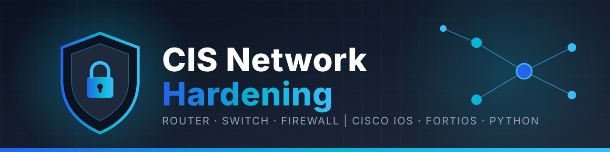

# 🔐 CIS Network Hardening

### Auditoría y hardening automatizado de Router, Switch y Firewall

> Laboratorio práctico de Seguridad Informática — Redes, Hardening y Seguridad de Infraestructura.


[🎥 Video](#video) · [🎯 Propósito](#proposito) · [🏗️ Topología](#topologia) · [🛡️ CIS](#cis) · [🐍 Script](#script) · [📊 Resultados](#resultados) · [🖼️ Evidencias](#evidencias) · [⚙️ Configs](#configs) · [🧠 Conclusiones](#conclusiones)

</div>

---

<a id="video"></a>
## 🎥 Video demostrativo

<div align="center">

[](https://youtu.be/1FThlVdLoFM)

</div>

> En este video se presenta el funcionamiento y las pruebas realizadas durante el laboratorio.

▶ **<https://youtu.be/1FThlVdLoFM>**

---

## 📑 Contenido

| | | |
|---|---|---|
| [📌 Descripción](#descripcion) | [🎯 Propósito y objetivos](#proposito) | [🏗️ Arquitectura y topología](#topologia) |
| [🛡️ CIS Benchmarks seleccionados](#cis) | [🐍 Script de Python](#script) | [🔧 Proceso de hardening](#hardening) |
| [📊 Resultados antes y después](#resultados) | [🖼️ Evidencias](#evidencias) | [🧪 Pruebas](#pruebas) |
| [⚙️ Running-configs](#configs) | [📂 Estructura del repositorio](#estructura) | [🧠 Conclusiones](#conclusiones) |
| [⚠️ Seguridad de la información](#seguridad) | [📚 Documentación detallada](#docs) | [👩‍💻 Autora](#autora) |

---

<a id="descripcion"></a>
## 📌 Descripción

Laboratorio de red con **router, switch y firewall** al que se le aplicó *hardening* basado en el **CIS Benchmark**. El proyecto incluye la topología construida en GNS3, las configuraciones de cada dispositivo (antes y después), un **script en Python** que audita y endurece los equipos, y los informes de cumplimiento generados.

| | |
|---|---|
| **Problema** | Los equipos de red suelen quedar con configuraciones inseguras: Telnet, SNMP con *communities* conocidas, HTTP sin cifrar, contraseñas reversibles y administración abierta a cualquier red. |
| **Qué se implementó** | Red con VLAN y enrutamiento entre ellas, auditoría CIS automatizada, hardening de **40 controles** (25 Cisco IOS y 15 FortiGate) y comparación del cumplimiento antes y después. |
| **Dispositivos** | R1 (router), SW1 (switch), FW1 (FortiGate) y tres hosts (PC-Admin, PC-User y servidor web). |
| **Tecnologías** | Cisco IOS 15.2 · FortiOS 7.0.9 · GNS3 · Python + Netmiko · CIS Benchmark |

<a id="proposito"></a>
## 🎯 Propósito y objetivos

> **Propósito:** comprobar que aplicar recomendaciones del CIS Benchmark reduce la superficie de ataque de la infraestructura de red, medirlo con un script propio y verificar que la red sigue funcionando.

| Pregunta | Respuesta |
|---|---|
| **¿Qué se quería lograr?** | Evaluar y mejorar la seguridad de una red usando un estándar reconocido. |
| **¿Qué se configuró?** | VLAN 10/20/99, enrutamiento inter-VLAN en R1, firewall FortiGate hacia NAT y los controles de hardening seleccionados. |
| **¿Qué aspecto de seguridad se trabajó?** | Autenticación, control de acceso a la administración, SSH, SNMP, servicios, logging y capa 2. |
| **¿Qué se esperaba comprobar?** | Que el cumplimiento aumentara y que los accesos inseguros dejaran de funcionar sin afectar la conectividad. |

**Objetivos**

- [x] Construir una red con router, switch y firewall.
- [x] Analizar los equipos contra el CIS Benchmark con una herramienta automatizada.
- [x] Aplicar recomendaciones de hardening y documentar por qué se aplicaron.
- [x] Desarrollar un script con modo *solo informe* y modo *aplicar + informe póstumo*.
- [ ] Probar cada recomendación con evidencia (ver [Pruebas](#pruebas): 9 completas, quedan pendientes).

📄 Más detalle: [`docs/01-proposito.md`](docs/01-proposito.md)

---

<a id="topologia"></a>
## 🏗️ Arquitectura y topología

<div align="center">
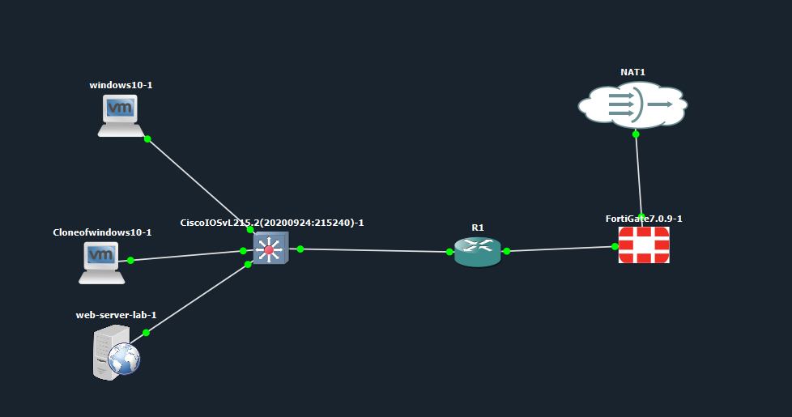

*Topología real del laboratorio en GNS3.*
</div>

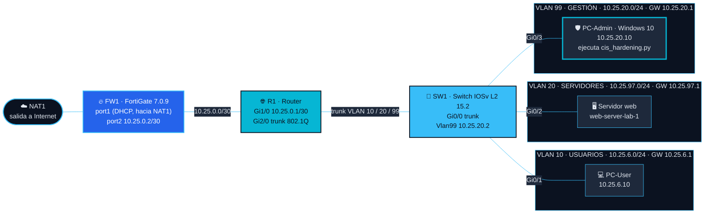

| Dispositivo | Función | Direccionamiento |
|---|---|---|
| **NAT1** | Salida a Internet | — |
| **FW1** · FortiGate 7.0.9 | Firewall perimetral | `port2` 10.25.0.2/30 · `port1` por DHCP |
| **R1** · Router (IOS 15.2) | Enrutamiento inter-VLAN | `Gi1/0` 10.25.0.1/30 · `Gi2/0.10` 10.25.6.1 · `Gi2/0.20` 10.25.97.1 · `Gi2/0.99` 10.25.20.1 |
| **SW1** · Switch IOSv L2 15.2 | VLAN y troncal | `Vlan99` 10.25.20.2 · `Gi0/1` VLAN 10 · `Gi0/2` VLAN 20 · `Gi0/3` VLAN 99 |
| **PC-Admin** · Windows 10 | Administración y ejecución del script | 10.25.20.10 (VLAN 99) |
| **PC-User** | Cliente de usuario | 10.25.6.10 (VLAN 10) |
| **Servidor web** | Servidor de pruebas (`web-server-lab-1`) | VLAN 20 · IP: **[AGREGAR]** |

### Flujo de administración tras el hardening *(resultado esperado)*

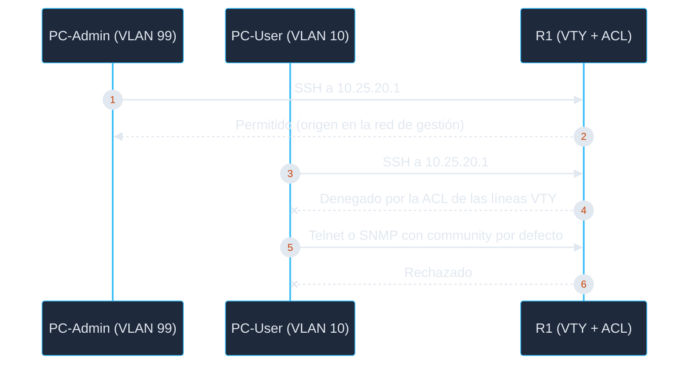

📄 Más detalle: [`docs/02-topologia.md`](docs/02-topologia.md)

---

<a id="cis"></a>
## 🛡️ CIS Benchmarks seleccionados

Se implementó una **selección de 40 controles**: 25 para Cisco IOS (router y switch) y 15 para FortiGate. Cada control está documentado con su riesgo, recomendación, configuración, justificación, prueba de validación y resultado antes y después.

| Categoría | Controles |
|---|:---:|
| Autenticación | 8 |
| Control de acceso | 6 |
| Logging y monitoreo | 5 |
| Hardening | 4 |
| Servicios | 4 |
| SSH | 3 |
| SNMP | 2 |
| Plano de datos | 2 |
| Capa 2 / VLAN | 2 |
| Políticas de firewall | 2 |
| Control de acceso / ACL | 1 |
| Cifrado | 1 |

| Dispositivo | Documentación por control | Controles evaluados |
|---|---|:---:|
| **R1** (router) | [`docs/controles/R1-router.md`](docs/controles/R1-router.md) | 23 |
| **SW1** (switch) | [`docs/controles/SW1-switch.md`](docs/controles/SW1-switch.md) | 24 |
| **FW1** (FortiGate) | [`docs/controles/FW1-firewall.md`](docs/controles/FW1-firewall.md) | 15 |

<details>
<summary><b>📋 Ver la lista completa de controles</b></summary>

> La numeración de Cisco corresponde a la versión 4.x del *CIS Cisco IOS 15 Benchmark* y puede variar según la versión. Los controles `L2-xx` son buenas prácticas de capa 2 y los `FGT-xx` se basan en las recomendaciones del *CIS FortiGate Benchmark*, sin número de sección.

| ID | Equipo | Categoría | Control | Ref. CIS |
|---|---|---|---|---|
| `MGT-01` | R1 / SW1 | Autenticación | Habilitar 'aaa new-model' | 1.1.1 |
| `MGT-02` | R1 / SW1 | Autenticación | Definir 'aaa authentication login default' | 1.1.2 |
| `MGT-03` | R1 / SW1 | Autenticación | Usar 'enable secret' (sin 'enable password') | 1.4.1 |
| `MGT-04` | R1 / SW1 | Autenticación | Habilitar 'service password-encryption' | 1.4.2 |
| `MGT-05` | R1 / SW1 | Autenticación | Usuarios locales con 'secret' (no 'password') | 1.4.3 |
| `MGT-06` | R1 / SW1 | Control de acceso | exec-timeout <= 10 min en consola | 1.2.7 |
| `MGT-07` | R1 / SW1 | Control de acceso | exec-timeout <= 10 min en VTY | 1.2.8 |
| `MGT-08` | R1 / SW1 | Control de acceso | 'transport input ssh' en VTY | 1.2.2 |
| `MGT-09` | R1 / SW1 | Control de acceso / ACL | ACL de acceso (access-class) en VTY | 1.2.4 / 1.2.5 |
| `MGT-10` | R1 / SW1 | Hardening | Configurar 'banner login' | 1.3.2 |
| `MGT-11` | R1 / SW1 | SNMP | Eliminar SNMP communities 'public'/'private' | 1.5.2 / 1.5.3 |
| `MGT-12` | R1 / SW1 | Servicios | Deshabilitar servidor HTTP ('no ip http server') | 2.1.x |
| `MGT-13` | R1 / SW1 | SSH | SSH versión 2 | 2.1.1.x |
| `MGT-14` | R1 / SW1 | SSH | 'ip ssh time-out' <= 60 s | 2.1.1.2 |
| `MGT-15` | R1 / SW1 | SSH | 'ip ssh authentication-retries' <= 3 | 2.1.1.3 |
| `CTL-01` | R1 / SW1 | Servicios | Deshabilitar CDP ('no cdp run') | 2.1.2 |
| `CTL-02` | R1 / SW1 | Servicios | 'no ip bootp server' | 2.1.3 |
| `CTL-03` | R1 / SW1 | Servicios | 'no service pad' | 2.1.8 |
| `CTL-04` | R1 / SW1 | Logging y monitoreo | 'logging buffered' >= 16384 | 2.2.2 |
| `CTL-05` | R1 / SW1 | Logging y monitoreo | Enviar logs a servidor syslog | 2.2.4 |
| `CTL-06` | R1 / SW1 | Logging y monitoreo | Timestamps con fecha/hora en logs y debug | 2.2.6 |
| `DAT-01` | R1 | Plano de datos | 'no ip source-route' | 3.1.1 |
| `DAT-02` | R1 / SW1 | Plano de datos | 'no ip proxy-arp' en interfaces L3 | 3.1.x |
| `L2-01` | SW1 | Capa 2 / VLAN | BPDU Guard por defecto en puertos PortFast | L2 (extra) |
| `L2-02` | SW1 | Capa 2 / VLAN | Port-security en puertos de acceso | L2 (extra) |
| `FGT-01` | FW1 | Hardening | Hostname distinto al valor por defecto | FortiGate · Sistema |
| `FGT-02` | FW1 | Hardening | Banner previo al login habilitado | FortiGate · Sistema |
| `FGT-03` | FW1 | Control de acceso | Timeout de inactividad de administración <= 5 min | FortiGate · Sistema |
| `FGT-04` | FW1 | Cifrado | Strong-crypto habilitado | FortiGate · Sistema |
| `FGT-05` | FW1 | Autenticación | Bloqueo de admin: umbral <= 3 intentos | FortiGate · Sistema |
| `FGT-06` | FW1 | Autenticación | Bloqueo de admin: duración >= 900 s | FortiGate · Sistema |
| `FGT-07` | FW1 | Control de acceso | Administradores con 'trusthost' restringido | FortiGate · Sistema |
| `FGT-08` | FW1 | Control de acceso | Sin Telnet ni HTTP en 'allowaccess' de interfaces | FortiGate · Red |
| `FGT-09` | FW1 | Autenticación | Política de contraseñas habilitada (longitud y complejidad) | FortiGate · Sistema |
| `FGT-10` | FW1 | SNMP | Agente SNMP deshabilitado | FortiGate · Sistema |
| `FGT-11` | FW1 | Logging y monitoreo | Logs enviados a servidor syslog | FortiGate · Logging |
| `FGT-12` | FW1 | Logging y monitoreo | Sincronización NTP habilitada | FortiGate · Sistema |
| `FGT-13` | FW1 | Políticas de firewall | Logging de tráfico en todas las políticas | FortiGate · Políticas |
| `FGT-14` | FW1 | Políticas de firewall | Sin políticas ANY-ANY-ALL con 'accept' | FortiGate · Políticas |
| `FGT-15` | FW1 | Hardening | Auto-instalación por USB deshabilitada | FortiGate · Sistema |

</details>

📄 Más detalle: [`docs/04-hardening.md`](docs/04-hardening.md)

---

<a id="script"></a>
## 🐍 Script de Python

[`scripts/cis_hardening.py`](scripts/cis_hardening.py) audita los equipos contra los controles seleccionados y, opcionalmente, aplica las correcciones. Conecta por SSH o Telnet con **Netmiko**, interpreta la configuración (Cisco IOS y FortiOS), evalúa cada control y genera informes HTML y JSON.

### Arquitectura

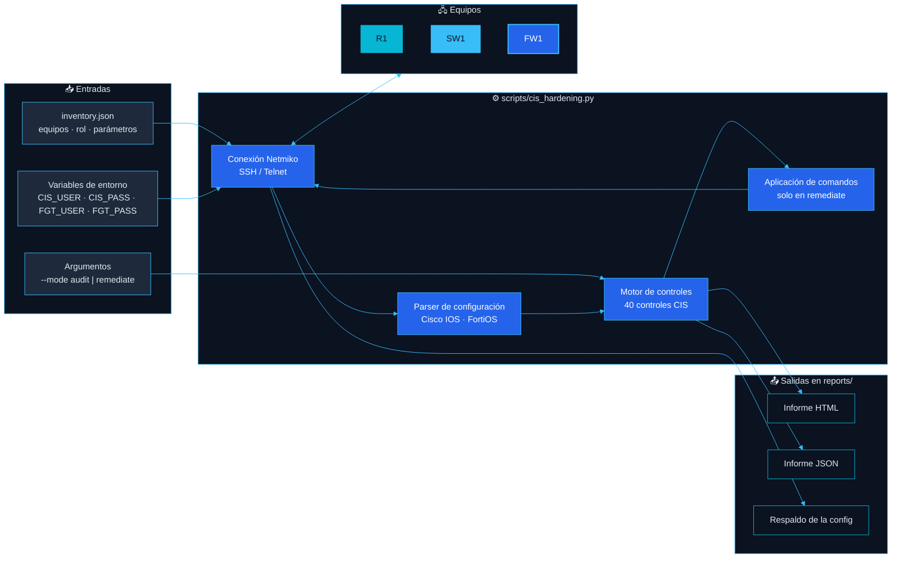

### Modos de ejecución

| Modo | Comando | ¿Modifica los equipos? | Qué hace |
|---|---|:---:|---|
| 🔍 **AUDIT** | `--mode audit` | ❌ No | Escanea y genera el informe de cumplimiento. |
| 🛠️ **APPLY** | `--mode remediate` | ✅ Sí, con confirmación | Respalda, aplica las reglas que fallan, re-escanea y genera el informe *antes / después*. |

### Flujo de auditoría

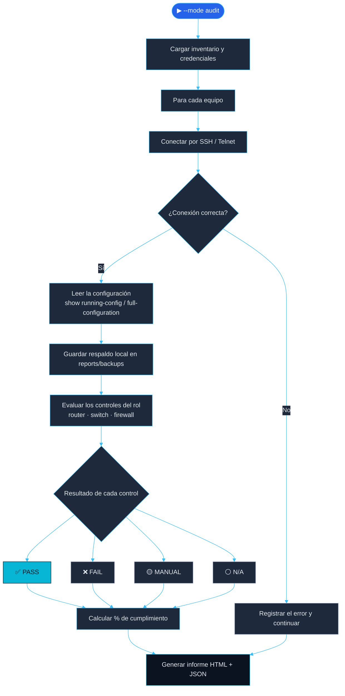

<details>
<summary><b>⌨️ Uso y opciones</b></summary>

```powershell
# Desde la raíz del repositorio (los informes se guardan en ./reports)
$env:CIS_USER="..."; $env:CIS_PASS="..."; $env:CIS_ENABLE="..."   # Cisco
$env:FGT_USER="..."; $env:FGT_PASS="..."                          # FortiGate

python scripts/cis_hardening.py --inventory scripts/inventory.json --mode audit
python scripts/cis_hardening.py --inventory scripts/inventory.json --mode remediate
python scripts/cis_hardening.py --list-controls
```

| Opción | Descripción |
|---|---|
| `--mode audit\|remediate` | Solo informe, o aplicar y generar informe póstumo (por defecto `audit`). |
| `--inventory` | Inventario de equipos (`scripts/inventory.json`). |
| `--offline ARCHIVO:ROL` | Trabaja sobre archivos de configuración, sin conectarse (pruebas). |
| `--only ID,ID` | Limita la ejecución a ciertos controles. |
| `--yes` | No pedir confirmación al aplicar. |
| `--outdir` | Carpeta de informes (por defecto `reports`). |

**Medidas de seguridad del script:** las credenciales se leen de variables de entorno (nunca de archivos), `audit` no modifica nada, `remediate` pide confirmación, es idempotente y no escribe secretos en los informes.

</details>

📄 Más detalle: [`scripts/README.md`](scripts/README.md)

---

<a id="hardening"></a>
## 🔧 Proceso de hardening

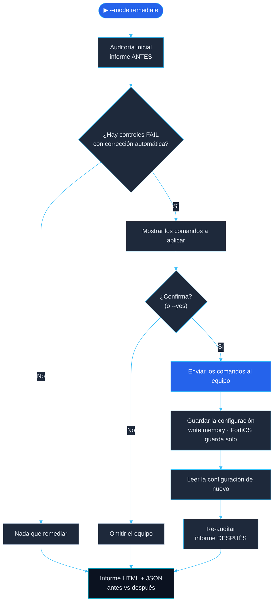

---

<a id="resultados"></a>
## 📊 Resultados antes y después

<div align="center">
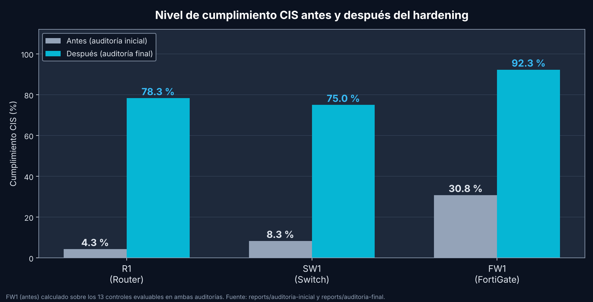
</div>

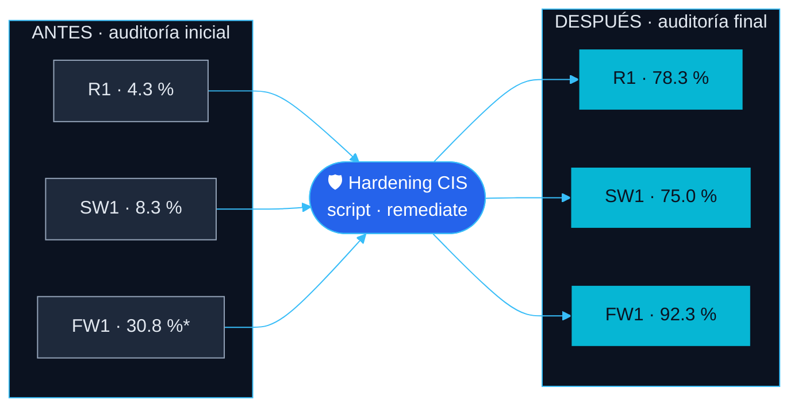

| Equipo | Antes | Después | Mejora | Controles cumplidos (antes → después) | Pendientes (después) |
|---|:---:|:---:|:---:|:---:|---|
| **R1** | 4.3 % | **78.3 %** | +74.0 pp | 1/23 → 18/23 | 2 manuales · 3 falsos negativos |
| **SW1** | 8.3 % | **75.0 %** | +66.7 pp | 2/24 → 18/24 | 2 manuales · 4 falsos negativos |
| **FW1** | 30.8 %\* | **92.3 %** | +61.5 pp | 4/13 → 12/13 | 1 fallo · 2 no evaluables |

> \* **FW1:** la auditoría inicial registró 33.3 % sobre 15 controles; en la final `FGT-13` y `FGT-14` son N/A porque el FortiGate no tenía políticas de firewall. Sobre los **13 controles evaluables en ambas fases** el cumplimiento inicial fue 30.8 % (coincide con la captura).

> [!NOTE]
> Los porcentajes salen de los informes reales: [`reports/auditoria-inicial`](reports/auditoria-inicial) y [`reports/auditoria-final`](reports/auditoria-final). Comparativa: [`reports/comparativa`](reports/comparativa/comparativa-antes-despues.html).

<details>
<summary><b>⚠️ Qué quedó pendiente y por qué (limitaciones observadas)</b></summary>

- **`MGT-06`, `MGT-07`, `MGT-15` (R1 y SW1): falso negativo confirmado en los equipos** (`show line` y `show ip ssh`). El valor que fijan (`exec-timeout 10 0` y `authentication-retries 3`) es el **valor por defecto de IOS**, y IOS no lo muestra en `show running-config`: en [`R1-despues.cfg`](configs/router/R1-despues.cfg) la línea `exec-timeout 0 0` de la consola desapareció. El script interpreta la ausencia como incumplimiento.
- **`L2-01` (SW1): falso negativo por sintaxis, confirmado en el equipo** (`show spanning-tree summary`). IOS 15.2 muestra `spanning-tree portfast edge bpduguard default` y el script busca `spanning-tree portfast bpduguard default`. El control sí quedó aplicado ([`SW1-despues.cfg`](configs/switch/SW1-despues.cfg)).
- **`MGT-03` y `MGT-05`:** requieren acción manual. En la configuración *después* siguen `enable password` y el usuario local con cifrado **tipo 7 (reversible)**.
- **`FGT-04` (FW1):** el parámetro `strong-crypto` no aparece en `show full-configuration` de FortiOS 7.0.9, por lo que el script no puede verificarlo.

</details>

📄 Más detalle: [`docs/06-resultados.md`](docs/06-resultados.md)

---

<a id="evidencias"></a>
## 🖼️ Evidencias

<details open>
<summary><b>1 · Topología y configuración</b></summary>

#### Topología en GNS3


**Qué se observa:** NAT1 conectado al FortiGate 7.0.9, este a R1, R1 al switch Cisco IOSv L2 15.2 y tres hosts (`windows10-1`, `Cloneofwindows10-1`, `web-server-lab-1`) conectados al switch.
**Qué demuestra:** la topología real sobre la que se realizó el laboratorio.

#### IP de PC-Admin
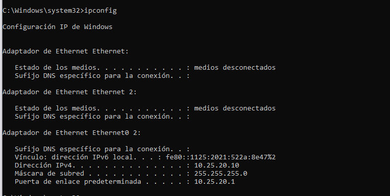

**Qué se observa:** adaptador `Ethernet0 2` con IPv4 `10.25.20.10`, máscara `255.255.255.0` y puerta de enlace `10.25.20.1`.
**Qué demuestra:** PC-Admin está en la VLAN 99 (gestión) y usa a R1 como gateway.

#### Interfaces de SW1 y R1
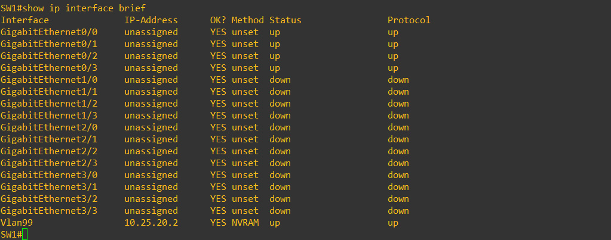

**Qué se observa:** en SW1, `Gi0/0` a `Gi0/3` en `up/up` y `Vlan99` con `10.25.20.2` en `up/up`.
**Qué demuestra:** el switch tiene los puertos del laboratorio activos y la interfaz de gestión configurada.

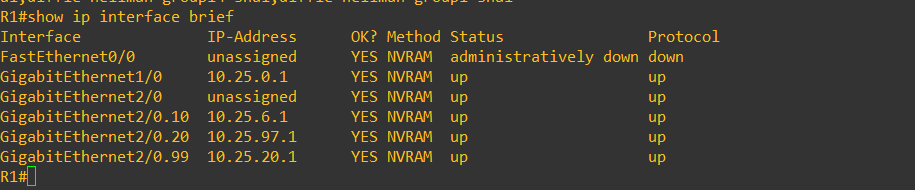

**Qué se observa:** `Gi1/0` 10.25.0.1, y las subinterfaces `Gi2/0.10` 10.25.6.1, `Gi2/0.20` 10.25.97.1 y `Gi2/0.99` 10.25.20.1, todas `up/up`.
**Qué demuestra:** R1 enruta las tres VLAN y el enlace hacia el FortiGate.

#### Conectividad desde PC-Admin
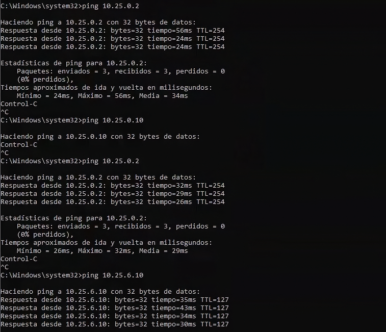

**Qué se observa:** respuestas de `10.25.0.2` (3/3) y de `10.25.6.10` (4/4); `10.25.0.10` sin respuesta (cancelado con Ctrl-C).
**Qué demuestra:** PC-Admin llega al FortiGate y al host de la VLAN 10 a través de R1.

</details>

<details>
<summary><b>2 · Auditoría inicial (antes del hardening)</b></summary>

> El script rotula como **ANTES** la lectura inicial de cada ejecución; en las auditorías finales también aparece esa etiqueta.

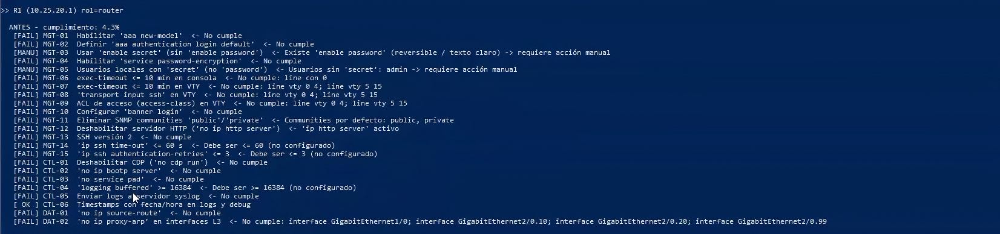

**Qué se observa:** R1 con **4.3 %** de cumplimiento; casi todos los controles en `FAIL`.
**Qué demuestra:** la configuración inicial del router era insegura.

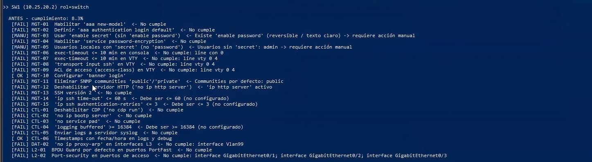

**Qué se observa:** SW1 con **8.3 %**; solo `MGT-10` y `CTL-06` cumplen.
**Qué demuestra:** el switch tampoco tenía hardening.

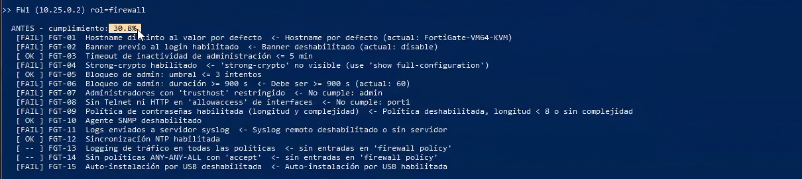

**Qué se observa:** FW1 con **30.8 %** (13 controles evaluables; `FGT-13` y `FGT-14` en N/A).
**Qué demuestra:** el FortiGate cumplía 4 de los 13 controles evaluables (`FGT-03`, `FGT-05`, `FGT-10` y `FGT-12`).

</details>

<details>
<summary><b>3 · Aplicación del hardening</b></summary>

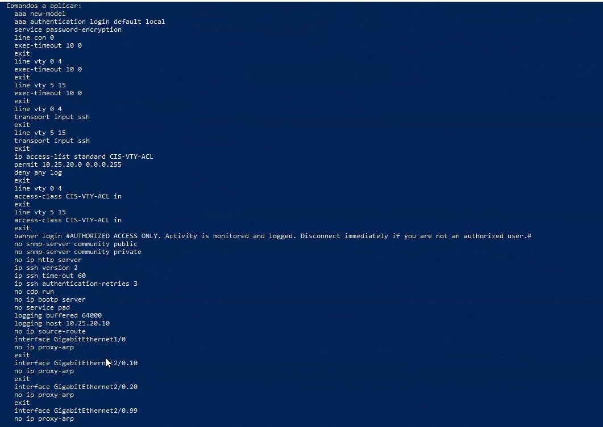

**Qué se observa:** la lista de comandos que el script va a enviar a R1 (AAA, timeouts, SSH, ACL de VTY, banner, SNMP, servicios, logging y `no ip proxy-arp`).
**Qué demuestra:** el modo `remediate` muestra exactamente qué se aplicará antes de pedir confirmación.

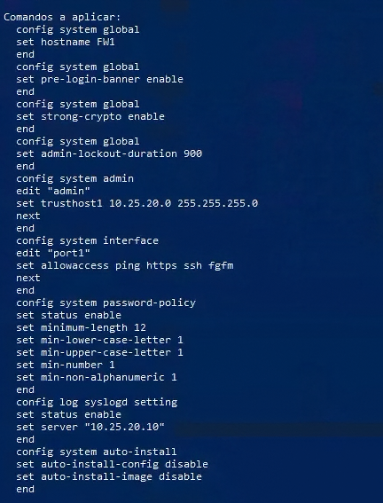

**Qué se observa:** comandos `config / edit / set` para el FortiGate: hostname, banner, `strong-crypto`, bloqueo de admin, `trusthost1`, `allowaccess`, política de contraseñas, syslog y auto-install.
**Qué demuestra:** el script aplica el hardening también a FortiOS.

</details>

<details>
<summary><b>4 · Auditoría final (después del hardening)</b></summary>

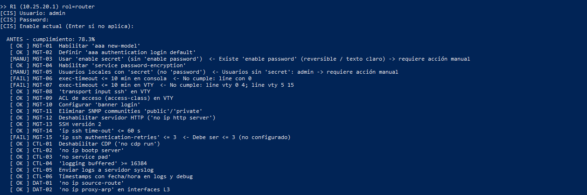

**Qué se observa:** R1 con **78.3 %**; restan `MGT-03` y `MGT-05` (manuales) y `MGT-06`, `MGT-07`, `MGT-15`.
**Qué demuestra:** el cumplimiento pasó de 4.3 % a 78.3 %.

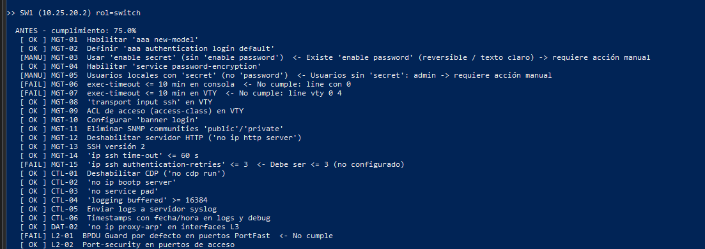

**Qué se observa:** SW1 con **75.0 %**; restan `MGT-03`, `MGT-05`, `MGT-06`, `MGT-07`, `MGT-15` y `L2-01`.
**Qué demuestra:** el cumplimiento pasó de 8.3 % a 75.0 %.

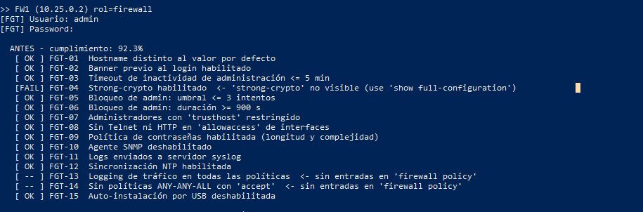

**Qué se observa:** FW1 con **92.3 %**; solo `FGT-04` en `FAIL` y `FGT-13`/`FGT-14` en N/A.
**Qué demuestra:** el cumplimiento pasó de 30.8 % a 92.3 %.

</details>

<details>
<summary><b>5 · Pruebas funcionales</b></summary>

> Las capturas que mostraban hashes de contraseñas tipo 7 (reversibles) se editaron para ocultarlos.

#### Telnet cerrado y SSH disponible
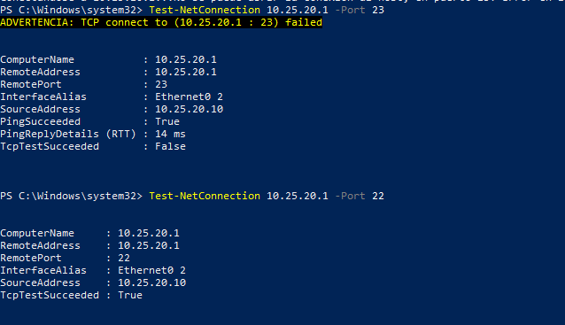

**Qué se observa:** desde PC-Admin (`10.25.20.10`), `Test-NetConnection` a R1: puerto **23 `False`** y puerto **22 `True`** (en SW1 el resultado es el mismo: [captura](evidence/06-pruebas/01-telnet-puerto23-cerrado-sw1.png)).
**Qué demuestra:** Telnet quedó deshabilitado (`transport input ssh`) y SSH sigue disponible.

#### SNMP por defecto eliminado y contraseñas
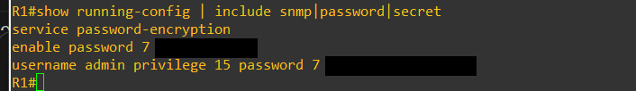

**Qué se observa:** sin ninguna línea `snmp-server community`; `service password-encryption` activo; `enable password` y el usuario local siguen con cifrado tipo 7 (hashes ocultos).
**Qué demuestra:** las *communities* `public`/`private` se eliminaron; las claves siguen siendo reversibles (pendiente: pasar a `secret`).

#### HTTP y CDP
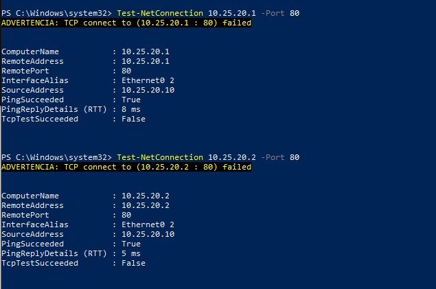

**Qué se observa:** puerto 80 `False` en `10.25.20.1` y `10.25.20.2`. CDP: `% CDP is not enabled` en [R1](evidence/06-pruebas/06-cdp-r1.png) y [SW1](evidence/06-pruebas/06-cdp-sw1.png).
**Qué demuestra:** el servidor HTTP y CDP están deshabilitados.

#### Valores por defecto de IOS (confirmación de los falsos negativos)
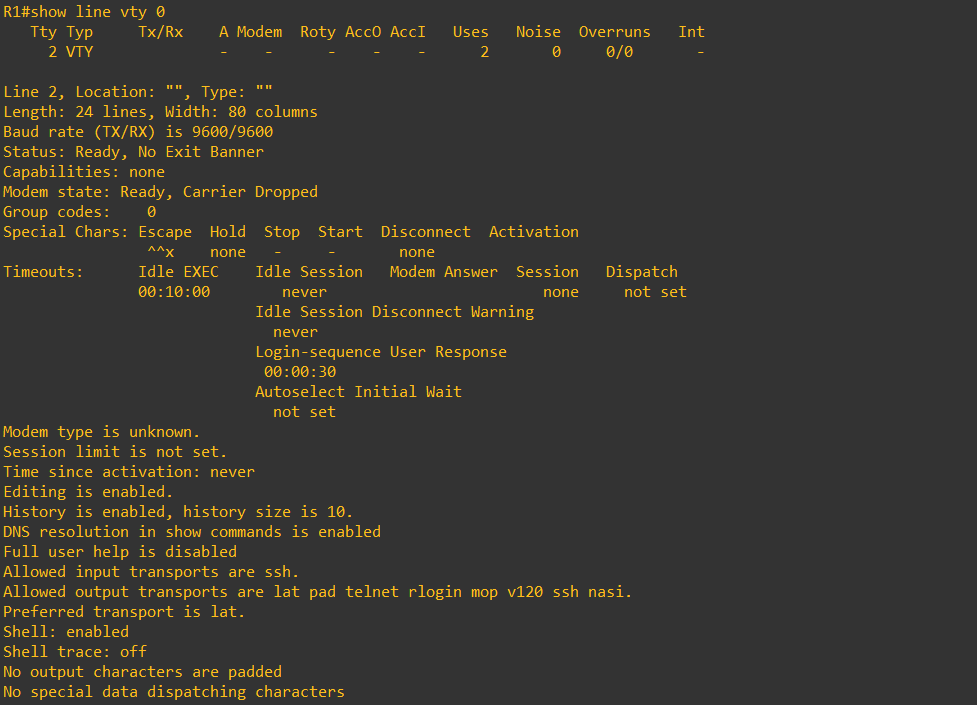

**Qué se observa:** en las VTY de R1, *Idle EXEC* de `00:10:00` y `Allowed input transports are ssh`. El mismo valor aparece en la consola de R1 ([captura](evidence/06-pruebas/07-show-line-con0-r1.png)) y en la consola y VTY de SW1 ([con 0](evidence/06-pruebas/07-show-line-con0-sw1.png) · [vty](evidence/06-pruebas/07-show-line-vty-sw1.png)).

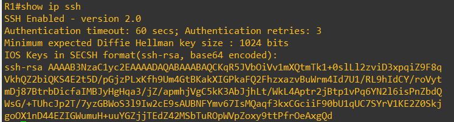

**Qué se observa:** `SSH Enabled - version 2.0`, `Authentication timeout: 60 secs` y `Authentication retries: 3` (igual en [SW1](evidence/06-pruebas/07-show-ip-ssh-sw1.png)).
**Qué demuestra:** `MGT-06`, `MGT-07` y `MGT-15` **sí están aplicados**; el script los marca como incumplidos porque IOS no muestra los valores por defecto en la configuración.

#### Port-security y BPDU Guard (SW1)
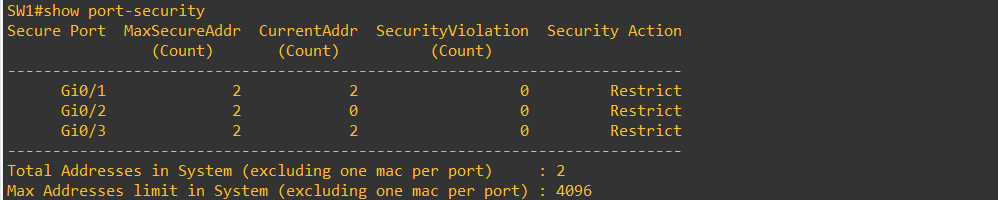

**Qué se observa:** `Gi0/1`, `Gi0/2` y `Gi0/3` con máximo 2 direcciones, 0 violaciones y acción `Restrict`.
**Qué demuestra:** port-security habilitado en los puertos de acceso.

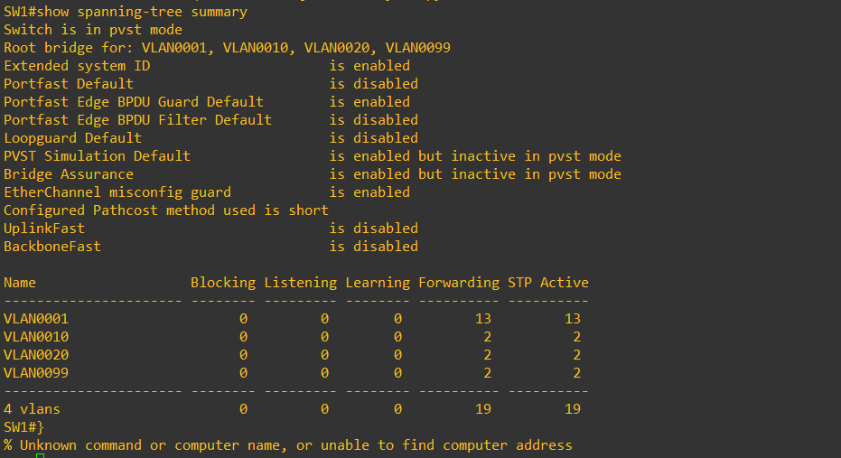

**Qué se observa:** `Portfast Edge BPDU Guard Default is enabled`.
**Qué demuestra:** BPDU Guard está aplicado (`L2-01`); el script lo marcaba como incumplido por la sintaxis `portfast edge` de IOS 15.2.

#### FortiGate (FW1)
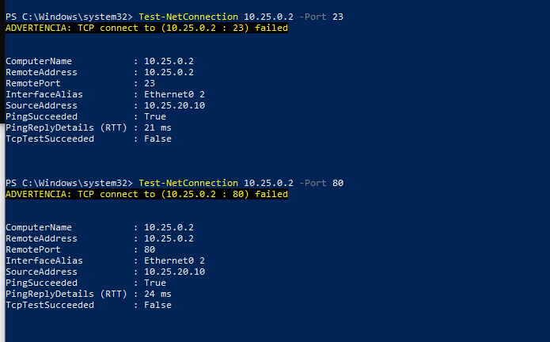

**Qué se observa:** desde PC-Admin, puertos **23** y **80** de `10.25.0.2` en `False`.
**Qué demuestra:** Telnet y HTTP no están disponibles en la interfaz que da hacia R1.

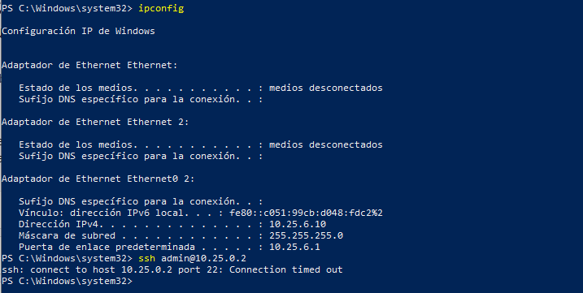

**Qué se observa:** desde PC-User (`10.25.6.10`), `ssh admin@10.25.0.2` termina en *Connection timed out*.
**Qué demuestra:** el administrador solo acepta conexiones desde la red de gestión (`trusthost`). *Falta el contraste desde PC-Admin.*

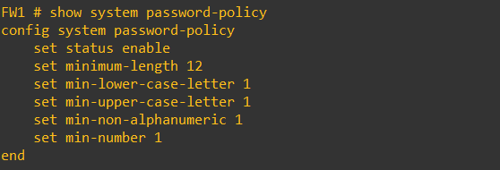

**Qué se observa:** `status enable`, `minimum-length 12` y complejidad mínima de 1 (minúscula, mayúscula, número y símbolo).
**Qué demuestra:** la política de contraseñas del FortiGate está activa.

</details>

---

<a id="pruebas"></a>
## 🧪 Pruebas

| Prueba | Resultado esperado | Estado |
|---|---|:---:|
| Re-ejecutar el script en modo `audit` | Cumplimiento superior al inicial | ✅ R1 78.3 % · SW1 75.0 % · FW1 92.3 % |
| Conectividad de PC-Admin hacia FW1 y PC-User | Respuesta a ping | ✅ |
| Telnet cerrado en R1 y SW1 (puerto 23) | Inaccesible | ✅ |
| SNMP por defecto eliminado | Sin `snmp-server community` | ✅ |
| HTTP cerrado en R1 y SW1 (puerto 80) | Inaccesible | ✅ |
| CDP deshabilitado | `% CDP is not enabled` | ✅ |
| Valores por defecto de IOS (`show line`, `show ip ssh`) | *Idle EXEC* 10 min · *retries* 3 | ✅ |
| Port-security y BPDU Guard en SW1 | Habilitados | ✅ |
| Telnet y HTTP cerrados en el FortiGate | Inaccesibles | ✅ |
| `trusthost` del FortiGate (desde PC-User) | Login denegado | 🟡 falta el contraste desde PC-Admin |
| Claves en `secret` (no tipo 7) | Hash fuerte | ⬜ pendiente (acción manual) |
| SSH permitido solo desde la VLAN 99 (ACL de las VTY) | PC-Admin entra, PC-User no | ⬜ pendiente |
| Logs en el servidor syslog (Wireshark) | Llegan con fecha y hora | ⬜ pendiente |
| Conectividad entre VLAN tras el hardening | Se mantiene | ⬜ pendiente |

> Detalle de cada prueba, comandos y capturas: [`docs/05-pruebas.md`](docs/05-pruebas.md)

---

<a id="configs"></a>
## ⚙️ Running-configs

Los archivos de configuración utilizados durante el laboratorio se encuentran organizados en:

```text
📁 configs/
├── router/    R1-antes.cfg · R1-despues.cfg
├── switch/    SW1-antes.cfg · SW1-despues.cfg
└── firewall/  FW1-antes.cfg · FW1-despues.cfg
```

| Archivo | Dispositivo | Estado |
|---|---|---|
| [`R1-antes.cfg`](configs/router/R1-antes.cfg) | R1 | Antes del hardening |
| [`SW1-antes.cfg`](configs/switch/SW1-antes.cfg) | SW1 | Antes del hardening |
| [`FW1-antes.cfg`](configs/firewall/FW1-antes.cfg) | FW1 | Antes del hardening |
| [`FW1-despues.cfg`](configs/firewall/FW1-despues.cfg) | FW1 | Después del hardening |
| [`R1-despues.cfg`](configs/router/R1-despues.cfg) | R1 | Después del hardening |
| [`SW1-despues.cfg`](configs/switch/SW1-despues.cfg) | SW1 | Después del hardening |

> Las contraseñas y claves se reemplazaron por `<REDACTED>`. Las *communities* SNMP por defecto se conservan porque son parte del hallazgo. Detalles en [`configs/README.md`](configs/README.md).

---

<a id="estructura"></a>
## 📂 Estructura del repositorio

```text
📁 cis-network-hardening-lab
│
├── 📄 README.md
├── 📁 docs/          documentación técnica (01–07) y fichas de controles
│   └── 📁 controles/   R1-router · SW1-switch · FW1-firewall
├── 📁 scripts/       cis_hardening.py · inventory.json · samples/
├── 📁 configs/       running-configs: router · switch · firewall
├── 📁 reports/       informes de auditoría (HTML y JSON)
├── 📁 evidence/      capturas de pantalla por fase
├── 📁 assets/        banner, topología y gráficas
├── 📁 video/         enlace del video demostrativo
├── 📄 LICENSE
└── 📄 .gitignore
```

| Carpeta | Contenido |
|---|---|
| [`docs/`](docs) | Propósito, topología, configuración, hardening, pruebas, resultados, conclusiones y fichas por control |
| [`scripts/`](scripts) | Script de auditoría/hardening, inventario y configuraciones de ejemplo |
| [`configs/`](configs) | Running-configs de los dispositivos |
| [`reports/`](reports) | Informes reales (inicial, final y comparativa) y ejemplos |
| [`evidence/`](evidence) | Capturas: topología, configuración, auditorías y hardening |
| [`assets/`](assets) | Banner, topología e imágenes de resultados |
| [`video/`](video) | Información del video demostrativo |

---

<a id="conclusiones"></a>
## 🧠 Conclusiones

- El script elevó el cumplimiento CIS en los tres equipos: **R1** de 4.3 % a 78.3 %, **SW1** de 8.3 % a 75.0 % y **FW1** de 30.8 % a 92.3 %.
- En total se remediaron **41 controles** (R1: 17, SW1: 16, FW1: 8) pasando de `FAIL` a `PASS`.
- La auditoría automatizada reveló además **limitaciones del propio método**, confirmadas con las configuraciones: los valores por defecto que IOS no muestra y la sintaxis `portfast edge` de IOS 15.2 generan falsos negativos (`MGT-06`, `MGT-07`, `MGT-15`, `L2-01`), y FortiOS 7.0.9 no expone `strong-crypto`.
- Algunos controles (`MGT-03`, `MGT-05`) no se automatizan a propósito: requieren decidir y proteger las contraseñas.

**Aprendizajes:** [AGREGAR: 3 o 4 aprendizajes personales]

📄 Más detalle: [`docs/07-conclusiones.md`](docs/07-conclusiones.md)

---

<a id="seguridad"></a>
## ⚠️ Seguridad de la información

| Elemento | Tratamiento en este repositorio |
|---|---|
| Contraseñas, `enable password`, usuarios locales y hashes `ENC` | Reemplazados por `<REDACTED>` |
| *Communities* SNMP `public` / `private` | Se conservan: son valores por defecto y el hallazgo que se corrige |
| Direccionamiento | Solo redes privadas del laboratorio |
| Respaldos del script (`reports/backups/`) | Excluidos por `.gitignore` |
| Credenciales del script | Solo por variables de entorno, nunca en archivos |

---

<a id="docs"></a>
## 📚 Documentación detallada

| | Documento |
|---|---|
| 1 | [🎯 Propósito](docs/01-proposito.md) |
| 2 | [🏗️ Topología](docs/02-topologia.md) |
| 3 | [⚙️ Configuración inicial](docs/03-configuracion.md) |
| 4 | [🛡️ Hardening con CIS](docs/04-hardening.md) |
| 5 | [🧪 Pruebas](docs/05-pruebas.md) |
| 6 | [📊 Resultados](docs/06-resultados.md) |
| 7 | [🧠 Conclusiones](docs/07-conclusiones.md) |
| ➕ | Controles: [R1](docs/controles/R1-router.md) · [SW1](docs/controles/SW1-switch.md) · [FW1](docs/controles/FW1-firewall.md) |

---

<a id="autora"></a>
## 👩‍💻 Autora

**Emely Carrasco**

`Cybersecurity Student | Blue Team & SOC | Networking`

<div align="center">

<sub>Proyecto académico · Laboratorio de Seguridad Informática</sub>

</div>
