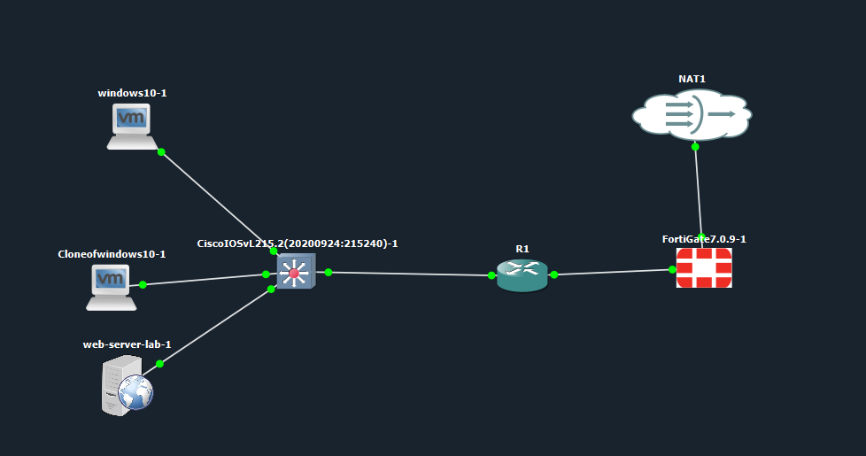
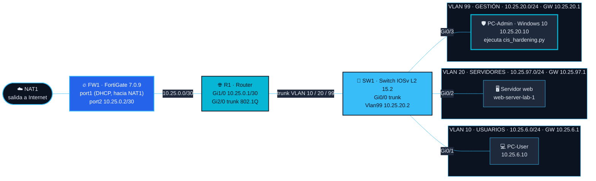
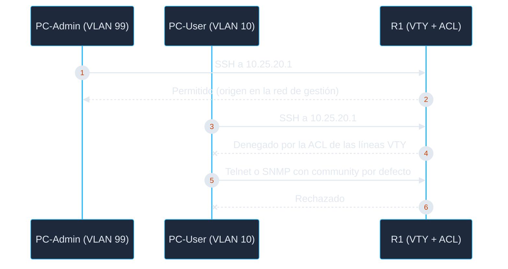

[🏠 Inicio](../README.md) · [◀ Propósito](01-proposito.md) · [Configuración ▶](03-configuracion.md)

# 🏗️ 02 · Topología

---

*Topología real en GNS3.*

## Diagrama de red

## Dispositivos

| Nodo en GNS3 | Rol | Sistema | Gestión |
|---|---|---|---|
| `NAT1` | Salida a Internet | Nodo NAT de GNS3 | — |
| `FortiGate7.0.9-1` (hostname `FW1`) | Firewall | FortiOS 7.0.9 (VM64-KVM) | 10.25.0.2 |
| `R1` | Router | Cisco IOS 15.2 | 10.25.20.1 |
| `CiscoIOSvL215.2(20200924:215240)-1` (hostname `SW1`) | Switch capa 2 | Cisco IOSv L2 15.2 | 10.25.20.2 |
| `windows10-1` / `Cloneofwindows10-1` | PC-Admin y PC-User | Windows 10 | 10.25.20.10 (PC-Admin) · 10.25.6.10 (PC-User) |
| `web-server-lab-1` | Servidor web | Servidor de GNS3 | VLAN 20 · IP: **[AGREGAR]** |

PC-User verificado con `ipconfig`: IP `10.25.6.10`, gateway `10.25.6.1` ([captura](../evidence/06-pruebas/13-fw-trusthost-pc-user-timeout.png)).

> **[AGREGAR]** cuál de los dos nodos Windows de GNS3 es PC-Admin y cuál PC-User.

## Direccionamiento

| VLAN | Nombre | Red | Gateway (R1) |
|---|---|---|---|
| 10 | USUARIOS | 10.25.6.0/24 | 10.25.6.1 (`Gi2/0.10`) |
| 20 | SERVIDORES | 10.25.97.0/24 | 10.25.97.1 (`Gi2/0.20`) |
| 99 | GESTIÓN | 10.25.20.0/24 | 10.25.20.1 (`Gi2/0.99`) |
| — | Enlace R1 ↔ FW1 | 10.25.0.0/30 | R1 `Gi1/0` 10.25.0.1 · FW1 `port2` 10.25.0.2 |

Ruta por defecto de R1: `0.0.0.0/0` vía `10.25.0.2` (FW1). El direccionamiento se derivó de la matrícula **2025-0697**.

## Interfaces

| Equipo | Interfaz | Función |
|---|---|---|
| R1 | `Gi1/0` 10.25.0.1/30 | Enlace hacia FW1 |
| R1 | `Gi2/0` (troncal 802.1Q) | Subinterfaces `.10`, `.20` y `.99` |
| R1 | `Fa0/0` | Apagada (*shutdown*) |
| SW1 | `Gi0/0` | Troncal hacia R1 |
| SW1 | `Gi0/1` · `Gi0/2` · `Gi0/3` | Acceso VLAN 10 · 20 · 99 |
| SW1 | `Vlan99` 10.25.20.2/24 | Gestión (gateway `10.25.20.1`) |
| FW1 | `port2` 10.25.0.2/30 | Enlace hacia R1 |
| FW1 | `port1` (DHCP) | Salida hacia NAT1 **[VERIFICAR]** |

Fuente: [`configs/`](../configs) y [capturas](../evidence/02-configuracion).

## Flujo de administración tras el hardening *(resultado esperado)*

> Describe el **resultado esperado**; las pruebas que lo comprueban están en [05-pruebas.md](05-pruebas.md).
