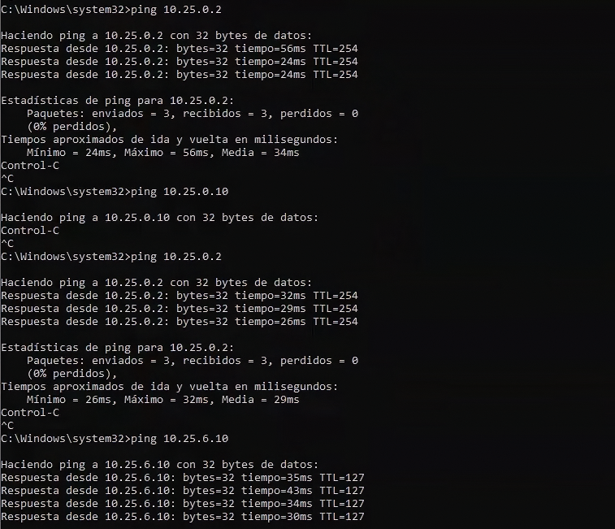

[🏠 Inicio](../README.md) · [◀ Topología](02-topologia.md) · [Hardening ▶](04-hardening.md)

# ⚙️ 03 · Configuración inicial

---

Estado de la red **antes** del hardening: funcional, pero con configuraciones inseguras que sirven de línea base. Las configuraciones completas están en [`configs/`](../configs).

## Hallazgos de la configuración inicial

| Dispositivo | Configuración insegura observada | Archivo |
|---|---|---|
| **R1** | `enable password` y usuario local con `password`; `transport input all` en las VTY; `ip http server`; SNMP `public` RO y `private` RW; `exec-timeout 0 0` en consola y *aux*; `no aaa new-model` | [`R1-antes.cfg`](../configs/router/R1-antes.cfg) → [`R1-despues.cfg`](../configs/router/R1-despues.cfg) |
| **SW1** | `enable password` y usuario local con `password`; `no service password-encryption`; `transport input telnet ssh`; `ip http server`; SNMP `public` RO; sin AAA | [`SW1-antes.cfg`](../configs/switch/SW1-antes.cfg) → [`SW1-despues.cfg`](../configs/switch/SW1-despues.cfg) |
| **FW1** | Hostname por defecto `FortiGate-VM64-KVM`; banner previo al login deshabilitado; bloqueo de admin de 60 s; `trusthost1 0.0.0.0/0`; `http` en `allowaccess`; política de contraseñas deshabilitada | [`FW1-antes.cfg`](../configs/firewall/FW1-antes.cfg) |

## Verificación de conectividad

**Qué se observa:** PC-Admin recibe respuesta de `10.25.0.2` (FW1) y de `10.25.6.10` (PC-User).
**Qué demuestra:** el enrutamiento a través de R1 funciona hacia el firewall y hacia la VLAN 10.

| Evidencia | Captura |
|---|---|
| IP de PC-Admin | [`01-ipconfig-pc-admin.png`](../evidence/02-configuracion/01-ipconfig-pc-admin.png) |
| Interfaces de SW1 | [`02-sw1-show-ip-interface-brief.png`](../evidence/02-configuracion/02-sw1-show-ip-interface-brief.png) |
| Interfaces de R1 | [`03-r1-show-ip-interface-brief.png`](../evidence/02-configuracion/03-r1-show-ip-interface-brief.png) |

## Dificultades encontradas

| Problema | Causa | Solución |
|---|---|---|
| Al conectar por SSH desde Windows: *no matching key exchange method found* ([captura](../evidence/06-pruebas/02-ssh-error-kex-r1.png)) | El IOS solo ofrece intercambios de clave SHA-1 (`diffie-hellman-group-exchange-sha1`, `group14-sha1`, `group1-sha1`) y el cliente OpenSSH de Windows los rechaza por defecto | **[AGREGAR confirmación]** Habilitarlos con `-oKexAlgorithms=+diffie-hellman-group14-sha1 -oHostKeyAlgorithms=+ssh-rsa` |
| El script no conectaba por SSH: *no acceptable kex algorithm* | Versión reciente de `paramiko` sin los algoritmos antiguos que ofrece el IOS del laboratorio | **[AGREGAR solución aplicada]** (p. ej. `paramiko==3.5.1` o Telnet con `cisco_ios_telnet`) |

> Conserve en esta tabla solo lo que realmente ocurrió.
