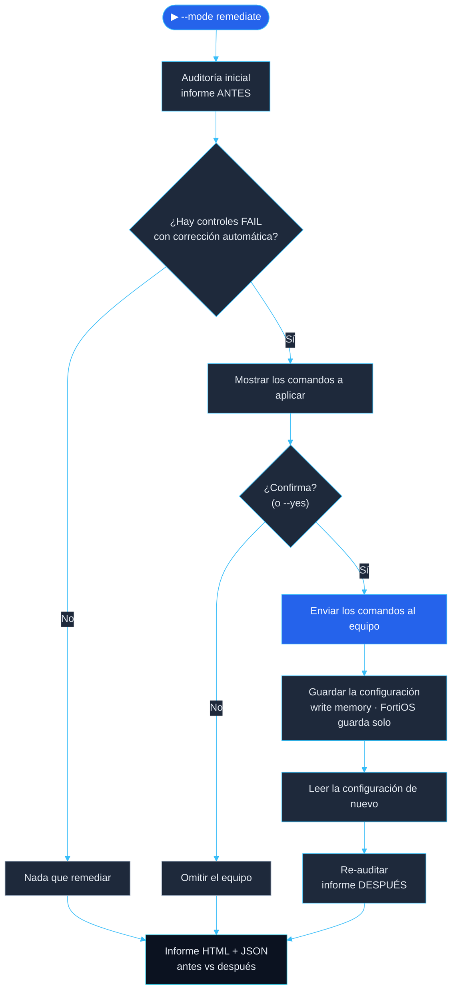

[🏠 Inicio](../README.md) · [◀ Configuración](03-configuracion.md) · [Pruebas ▶](05-pruebas.md)

# 🛡️ 04 · Hardening con CIS Benchmark

---

## Herramienta de análisis

| Herramienta | Uso |
|---|---|
| **`cis_hardening.py`** (propia) | Auditoría y remediación de los controles seleccionados en Cisco IOS y FortiOS → [`scripts/`](../scripts) |
| **[AGREGAR]** | CIS-CAT / Nipper / otra, solo si se usó |

## Proceso

## Documentación por control

Cada ficha incluye identificador, dispositivo, riesgo, recomendación, configuración aplicada, justificación, prueba de validación y resultado antes y después.

| Dispositivo | Ficha | Cumplimiento |
|---|---|---|
| **R1** (router) | [`controles/R1-router.md`](controles/R1-router.md) | 4.3 % → 78.3 % |
| **SW1** (switch) | [`controles/SW1-switch.md`](controles/SW1-switch.md) | 8.3 % → 75.0 % |
| **FW1** (FortiGate) | [`controles/FW1-firewall.md`](controles/FW1-firewall.md) | 30.8 % → 92.3 % |

## Controles que no se automatizan

| Control | Motivo |
|---|---|
| `MGT-03` `enable secret` | Solo se automatiza si se define `CIS_ENABLE_NEW`; no se escriben claves en archivos ni informes. |
| `MGT-05` usuarios con `secret` | El script no conoce la contraseña, por lo que no puede generar el hash. |
| `FGT-14` política ANY-ANY-ALL | Decidir qué tráfico se permite es una decisión de diseño. |
