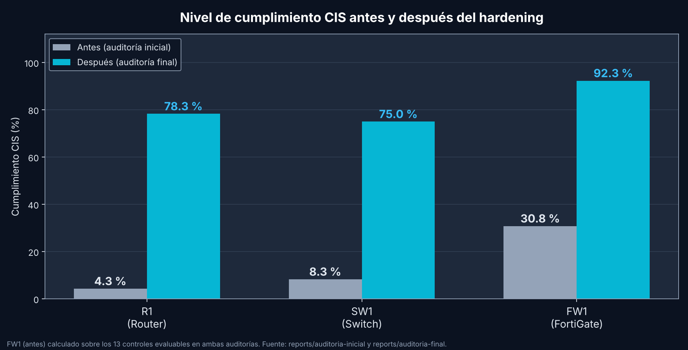
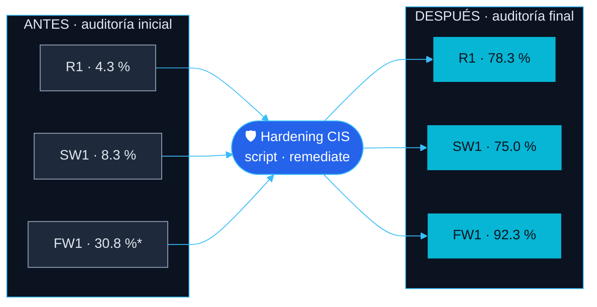

[🏠 Inicio](../README.md) · [◀ Pruebas](05-pruebas.md) · [Conclusiones ▶](07-conclusiones.md)

# 📊 06 · Resultados

---

## Cumplimiento por equipo

| Equipo | Antes | Después | Mejora | Cumplidos (antes → después) | Manuales | Fallos |
|---|:---:|:---:|:---:|:---:|:---:|:---:|
| **R1** | 4.3 % | **78.3 %** | +74.0 pp | 1/23 → 18/23 | 2 | 3 |
| **SW1** | 8.3 % | **75.0 %** | +66.7 pp | 2/24 → 18/24 | 2 | 4 |
| **FW1** | 30.8 % | **92.3 %** | +61.5 pp | 4/13 → 12/13 | 0 | 1 |

> **FW1:** la auditoría inicial registró **33.3 %** sobre 15 controles (existía una política de firewall, por lo que `FGT-13` y `FGT-14` se evaluaron). En la final esos dos son N/A. Sobre los 13 controles evaluables en ambas fases, el cumplimiento inicial fue **30.8 %**, que coincide con la [captura](../evidence/03-auditoria-inicial/03-audit-inicial-fw1.png).

## Controles remediados (FAIL → PASS)

| Equipo | Controles remediados |
|---|:---:|
| R1 | 17 |
| SW1 | 16 |
| FW1 | 8 |
| **Total** | **41** |

## Controles que siguen sin cumplirse

| Equipo | Control | Observación |
|---|---|---|
| R1, SW1 | `MGT-03`, `MGT-05` | Requieren acción manual. |
| R1, SW1 | `MGT-06`, `MGT-07`, `MGT-15` | **Falso negativo confirmado en los equipos:** `show line` indica *Idle EXEC 00:10:00* y `show ip ssh` indica *retries 3* ([pruebas](05-pruebas.md)). IOS no muestra los valores por defecto en la configuración. |
| SW1 | `L2-01` | **Falso negativo confirmado en el equipo:** `show spanning-tree summary` indica *Portfast Edge BPDU Guard Default is enabled* ([captura](../evidence/06-pruebas/12-bpduguard-sw1.png)). IOS 15.2 muestra `portfast edge bpduguard default`. |
| FW1 | `FGT-04` | `strong-crypto` no aparece en `show full-configuration`. **[AGREGAR verificación manual]** |

## Cambios observados en la configuración del FortiGate

Comparación real entre [`FW1-antes.cfg`](../configs/firewall/FW1-antes.cfg) y [`FW1-despues.cfg`](../configs/firewall/FW1-despues.cfg):

| Parámetro | Antes | Después |
|---|---|---|
| `hostname` | `FortiGate-VM64-KVM` | `FW1` |
| `pre-login-banner` | `disable` | `enable` |
| `admin-lockout-duration` | `60` | `900` |
| `trusthost1` (admin) | `0.0.0.0 0.0.0.0` | `10.25.20.0 255.255.255.0` |
| `allowaccess` (port1) | `ping https ssh http fgfm` | `ping https ssh fgfm` |
| `system password-policy` | `status disable` | `status enable`, longitud 12 y complejidad |

## Cambios observados en R1 (antes → después)

Comparación real entre [`R1-antes.cfg`](../configs/router/R1-antes.cfg) y [`R1-despues.cfg`](../configs/router/R1-despues.cfg):

| Aspecto | Antes | Después |
|---|---|---|
| AAA | `no aaa new-model` | `aaa new-model` + `aaa authentication login default local` |
| Contraseñas de línea | sin `service password-encryption` | `service password-encryption` |
| Acceso VTY | `transport input all`, sin ACL | `transport input ssh` + `access-class CIS-VTY-ACL in` |
| Consola | `exec-timeout 0 0` | sin línea `exec-timeout` (valor por defecto, 10 min) |
| SSH | sin configuración | `ip ssh version 2` · `ip ssh time-out 60` |
| HTTP | `ip http server` | `no ip http server` |
| SNMP | `public` RO y `private` RW | sin *communities* |
| Servicios | CDP, BOOTP y PAD activos; `source-route` permitido | `no cdp run` · `no ip bootp server` · `no service pad` · `no ip source-route` |
| Logging | sin buffer ni servidor | `logging buffered 64000` · `logging host 10.25.20.10` |
| Banner | sin `banner login` | `banner login` con aviso de acceso autorizado |
| Proxy ARP | habilitado | `no ip proxy-arp` en las 4 interfaces L3 |
| `enable password` / usuario local | texto claro | **tipo 7 (reversible)** · pendiente de pasar a `secret` |
| `line aux 0` | `exec-timeout 0 0` | sin cambios (no estaba entre los controles seleccionados) |

## Cambios observados en SW1 (antes → después)

Comparación real entre [`SW1-antes.cfg`](../configs/switch/SW1-antes.cfg) y [`SW1-despues.cfg`](../configs/switch/SW1-despues.cfg):

| Aspecto | Antes | Después |
|---|---|---|
| AAA | `no aaa new-model` | `aaa new-model` + `aaa authentication login default local` |
| Contraseñas de línea | `no service password-encryption` | `service password-encryption` |
| Acceso VTY | `transport input telnet ssh`, sin ACL | `transport input ssh` + `access-class CIS-VTY-ACL in` |
| SSH | sin `version 2` ni *time-out* | `ip ssh version 2` · `ip ssh time-out 60` |
| HTTP | `ip http server` | `no ip http server` (`ip http secure-server` sigue activo) |
| SNMP | `public` RO | sin *communities* |
| Servicios | CDP, BOOTP y PAD activos | `no cdp run` · `no ip bootp server` · `no service pad` |
| Logging | sin buffer ni servidor | `logging buffered 64000` · `logging host 10.25.20.10` |
| Port-security | sin configuración | `maximum 2` · `violation restrict` · `mac-address sticky` en `Gi0/1`, `Gi0/2` y `Gi0/3` |
| BPDU Guard | sin configuración | `spanning-tree portfast edge bpduguard default` |
| Proxy ARP (`Vlan99`) | habilitado | `no ip proxy-arp` |
| `enable password` / usuario local | texto claro | **tipo 7 (reversible)** · pendiente de pasar a `secret` |

## Informes generados

| Informe | Archivo |
|---|---|
| Auditoría inicial | [`reports/auditoria-inicial/`](../reports/auditoria-inicial) |
| Auditoría final | [`reports/auditoria-final/`](../reports/auditoria-final) |
| Comparativa antes / después | [`comparativa-antes-despues.html`](../reports/comparativa/comparativa-antes-despues.html) |

> No se cuenta con el informe de la ejecución `remediate` (con la lista de comandos aplicados y los errores del equipo). **[AGREGAR si existe]**
